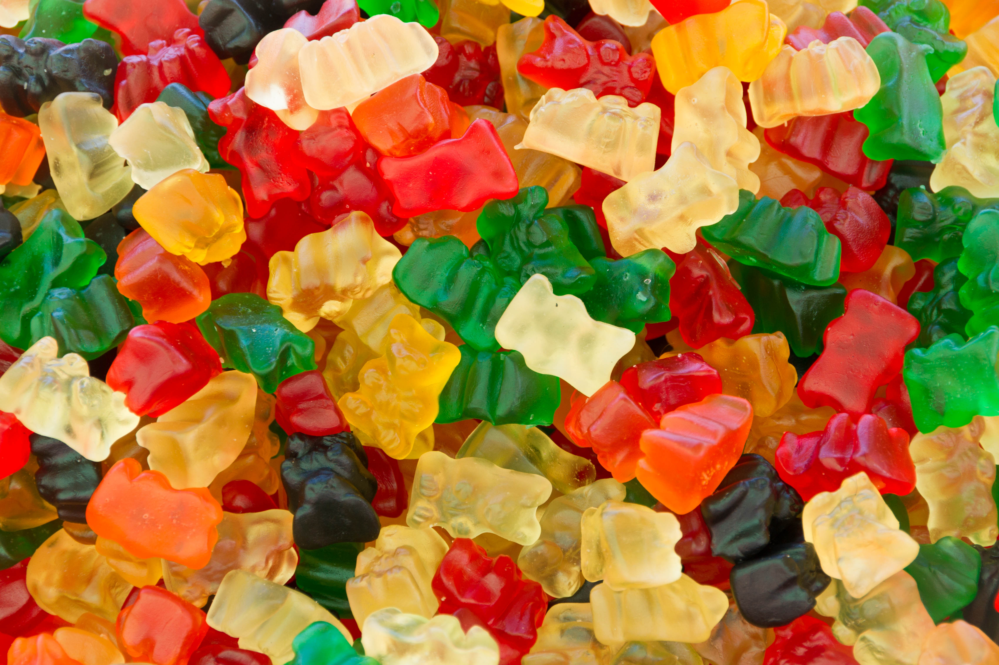

## Summary

In this exercise, we will provide you three bags of 200 gummy candies as different species pools. You will divide into three working groups, and every one of you will sample a proportion of individuals. We will provide a species key to you, so you can easily determine the species and create a vector. Every group will combine these vectors to asses the differences between each sampling. It is very similar to the simulation exercise and plot-based sampling that you have done earlier.  We constructed these communities with different richness and evenness. So you can compare your results and discuss as a group after analyzing your data. Below we summarized the sampling steps, and provided a guideline for analyzes. 

{width=50%}

## Sampling and exploration steps

1. Divide into three groups. Each of you will have a species pool: A, B and C. Please note down your pool, your group name (if you wish), your names. 

2. Each of you will randomly sample 30 species, identify the species and the abundances. Do not forget to note down who sampled which vector. You can name the vectors as site 1-n. 

3. Using your vector calculate at least two alpha diversity indices based on the methods you have learned. 

4. Combine your vectors with other group members to explore beta diversity and based on the methods you have learned.

5. Discuss your results, and the sources of differences. 

6. Upload your site by species matrix to GitHub. 

7. Using control structures and cheat sheets provided, you will pool and wrangle this data and explore summary statistics. 

8. Test a hypothesis to explain differences between source communities and sites using the hypothesis testing methods you have learned. 

## Example methods you can use

### Individual work 

Site by species vector: alpha diversity
* Number of individuals
* Number of species
* Shannon entropy
* Simpson index
* Hill numbers 

### Group work with pooled data

*Pairs of plots: Beta–diversity, turnover in species composition*

* Jaccard index = a/(a + b + c) 

* Sørensen index = 2a/(2a + b + c) 

*(a: number or species in plot A and plot B, b: number of species in plot A and NOT in B,
c: number of species NOT in A but in B) 

*Set of plots (pooled): gamma - diversity*

* Number of individuals

* Number of species

* Entropies, Hill numbers

*Set of plots (pooled): further exploration and hypotheis testing*

* Rarefaction curve

* Species accumulation curves

* Extrapolated (asymptotic) richness

* An ordination method (e.g. PCoA)

* An hypothesis testing method (e.g. Permanova)

